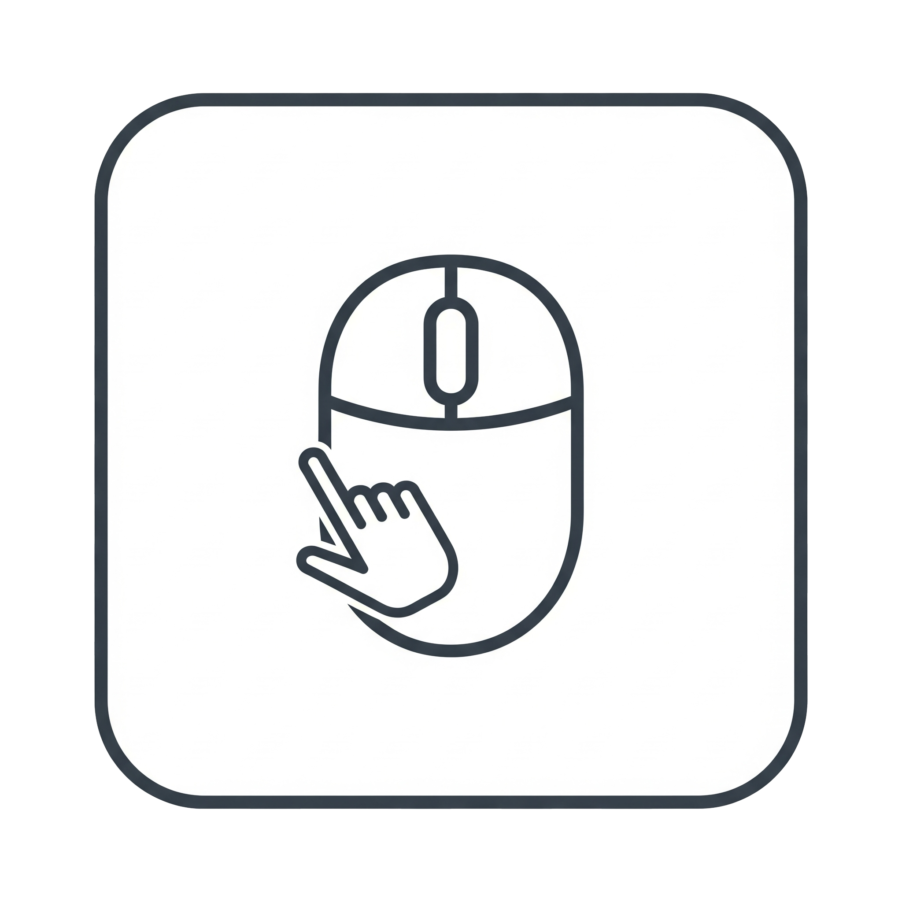

<h1 align="center">
  
  <br>
  <a href="https://github.com/Hfugghg/MouseClicker">MouseClicker</a>
  <br>
</h1>

MouseClicker 是一款功能强大的 Windows 桌面应用程序，旨在自动执行鼠标点击任务。无论您是需要执行重复性点击任务，还是希望在指定屏幕区域内实现自动化操作，MouseClicker 都能为您提供灵活、可靠的解决方案。

## 📥 下载

从 [GitHub Releases](https://github.com/Hfugghg/MouseClicker/releases) 获取最新版本：

*   **安装版（推荐）**：`MouseClicker-Setup-*.exe`，自包含，已内置 .NET 10 运行时，下载后直接安装。
*   **便携版**：`MouseClicker-Portable-*.zip`，体积小，但需要先安装 [.NET 10 Desktop Runtime](https://dotnet.microsoft.com/download/dotnet/10.0)。Windows 自带的是 .NET Framework 4.8，不自带 .NET 10。

## ✨ 功能特性

*   **多区域点击**：自由添加、管理多个屏幕点击区域。
*   **可视化区域选择**：通过拖拽矩形框，直观地在屏幕上选择您希望点击的范围。
*   **自定义标签**：为每个点击区域设置清晰的名称，方便管理。
*   **快速取消选择**：再次点击列表中已选中的区域即可取消选择。
*   **灵活的时间控制**：
    *   **点击间隔**：自定义每次点击之间的基础间隔时间（毫秒）。
    *   **随机抖动**：为基础间隔加上或减去可配置的随机偏移量；总等待时间为负数时取绝对值，并保留最短 10ms 等待。抖动大于间隔时，界面会提示平均等待时间变长。
*   **多样的点击序列**：
    *   **顺序循环**：按列表顺序依次点击，完成后从头开始。
    *   **随机点击**：在所有区域中随机选择一个进行点击。
    *   **点击一次**：按顺序点击完所有区域后自动停止。
*   **SendInput 输入模式**：使用 Windows `SendInput` API 发送合成鼠标输入事件。`dwExtraInfo` 只是附加信息，不会将软件生成的事件变成真实硬件输入，也不保证绕过目标软件的检测。
*   **可视化辅助**：
    *   **区域覆盖层**：在虚拟桌面范围内实时显示所有已定义的点击区域边框，并可随时开启或关闭。
    *   **列表定位**：悬停或选中区域列表中的项目时，用蓝色边框标出对应区域。
    *   **当前点击区域**：自动点击时可用绿色边框标出当前区域。“点击时高亮区域”默认开启，可关闭，并随配置保存；加载旧配置时也默认开启。以上定位与高亮仅在“显示区域框”开启时可见。
*   **一键启停与可配置热键**：
    *   **主控按钮**：通过界面按钮轻松开始或停止点击任务。
    *   **自定义启停热键**：默认使用 `F6`，可在“设置 → 热键设置”中点击输入框后按下所需按键；支持 F6–F12、Insert、Home、End、PageUp、PageDown 或 Pause，请勿同时按住 Ctrl/Alt/Shift/Win；设置保存在当前 Windows 用户的本地应用数据中。
    *   **ESC 紧急停止**：在点击过程中，随时按下 `ESC` 键可立即停止任务。
*   **区域独立鼠标按键**：右键点击区域列表中的项目，可为该区域选择鼠标左键或右键；默认左键，并随配置 JSON 保存。列表中的 `[L]` / `[R]` 标记用于区分按键。
*   **条件点击**：为每个区域配置独立的检测范围和目标图片，检测到画面后才点击原来的点击区域。支持出现一次点击一次、画面存在期间重复点击，以及不发送鼠标输入的识别测试。模板图片随 JSON 配置保存。
*   **配置管理**：
    *   **保存配置**：将当前的点击区域、时间设置和序列模式保存为 JSON 文件。
    *   **加载配置**：随时加载之前保存的配置，快速恢复工作场景。
*   **多语言支持**：界面支持与安装程序一致的 10 种语言：简体中文、繁體中文、English、日本語、한국어、Français、Deutsch、Español、Русский、Português (Brasil)。应用首次启动默认匹配设备显示语言；不支持的语言回退到英语，也可通过“语言”菜单切换。
*   **多语言安装程序**：安装向导支持上述 10 种语言。
*   **关于与更新**：
    *   **项目地址**：“关于”窗口提供项目页面链接。
    *   **后台检查**：启动后在后台检查 GitHub 最新正式 Release；发现较新版本时，在“关于”菜单下方显示“有更新”。离线或检查失败不阻塞使用。
    *   **查看与跳过**：可在“关于”中打开版本发行页面，或跳过指定版本的提示。跳过设置会保存，后续发现其他新版本时仍会提示。
*   **内置帮助文档**：“帮助 → 查看教程”统一打开使用教程，按功能提供目录和全文搜索，覆盖快速上手、区域与按键、执行顺序、识图设置、参数、排错及配置。教程为非模态窗口，可与程序并排，边看边操作；条件编辑窗口保留识图指南按钮，可直接跳转到对应章节。截图、选区和测试识别时教程会临时隐藏，结束后自动恢复。

## 🚀 如何使用

1.  **添加点击区域**：
    *   点击 "**添加**" 按钮。
    *   屏幕将被一层半透明的遮罩覆盖，此时您可以按住鼠标左键并拖拽，以选择一个矩形区域。
    *   选定后，在弹出的对话框中为该区域命名。
2.  **管理区域列表**：
    *   在主界面的列表中，您可以查看所有已添加的区域。
    *   使用 "**移除**"、"**上移**"、"**下移**" 按钮来管理您的点击列表。
    *   再次点击已选中的区域可取消选择。
    *   开启“显示区域框”后，可将鼠标停在列表项目上或选中项目，通过蓝色边框定位区域；自动点击时，绿色边框标出当前区域，可用“点击时高亮区域”开关控制。
3.  **设置点击参数**：
    *   设置 "**间隔**" 和 "**抖动**" 时间（以毫秒为单位）；抖动可以大于间隔，此时会显示平均等待时间变长的提示。
    *   在 "**序列**" 下拉菜单中选择您想要的点击模式（循环、随机或一次）。
    *   勾选相应选项可使用 `SendInput` API 发送合成鼠标输入事件。
4.  **开始任务**：
    *   点击 "**开始点击**" 按钮启动自动点击。
    *   程序将根据您的设置，在指定区域内模拟鼠标点击。
5.  **停止任务**：
    *   点击 "**停止点击**" 按钮。
    *   或者，直接按下键盘上的 `ESC` 键。

## 🖼️ 条件点击

1. 先添加一个**点击区域**，它决定最终鼠标点在哪里。
2. 选中该项后点击“编辑条件”按钮（也可右键选择或双击），启用画面条件。
3. 框选**检测区域**，之后才能截图或导入模板。截图框可自由移动、调整边角，但宽高不超过检测区域；点击选框旁跟随移动的 √ 确认、× 取消，也支持 Enter / Esc。图片裁剪框同样提供跟随按钮。导入保留整张原图，可通过独立按钮选择裁剪，取消不改变原模板。模板截图、检测区域和点击区域可以位于不同位置或显示器。
4. 设置匹配阈值、检测间隔、触发方式和等待超时。默认阈值为 `0.90`、检测间隔为 `200ms`、超时为 `60s`；超时为 `0` 表示一直等待。
5. 使用“测试识别”查看当前画面的匹配分数和命中位置，确认后保存条件，再开始任务。测试识别不会点击鼠标。

**触发规则：**连续两帧匹配才允许点击。“出现一次点击一次”在点击后保持锁定，连续两帧不匹配才重新允许触发；启动时目标已存在也会触发首次点击。“存在期间重复点击”沿用主界面的点击间隔和抖动，每次点击前需要新的识别结果。后台也会观察其他任务的条件，以记录画面的消失；短于检测间隔的画面变化可能漏检。

**序列规则：**顺序模式等待当前项满足条件并点击，之后才进入下一项；随机模式先选定一项，再等待该项满足条件。条件不满足时不会跳过该项。等待超时、截图失败或模板失效会停止整个任务并提示原因。普通点击项与条件点击项可以混用；停止并重新开始会重置识别状态。

**识别范围：**通过 OpenCV 模板匹配识别当前可见桌面，不支持识别被其他窗口遮挡或已最小化的内容。请将主窗口移出检测区域。新条件默认开启“自动适应目标大小”，在有界范围内搜索多个等比例尺寸，会增加识别耗时，不保证任意缩放。旧配置默认保留原尺寸匹配，可手动开启自动适应；旋转、主题或外观变化仍可能需要重新截图；匹配分数不是正确率。Windows 10 2004 及以上可在条件执行期间保留顶层区域框，同时将其排除在识别截图之外；不支持或设置失败时自动隐藏区域框，避免干扰识别。模板图片内嵌于 JSON 配置中，无须维护外部图片路径；旧配置仍按普通点击加载。

**检测框与模板尺寸：**“显示检测区域”是独立开关，用橙色虚线标出已启用条件的检测范围，与点击区域框互不影响。支持截图排除时两种框都不进入识别画面；不支持或设置失败时，条件执行期间自动隐藏。模板可从桌面任意位置自由截图，包括其他显示器。原始图片支持最多 32 MiB、32M 像素；导入不自动裁剪或改写原图。原尺寸模式要求模板尺寸不超过检测区域，不合时可开启自动适应、可选裁剪或扩大检测区。测试识别显示匹配比例、命中大小和位置框。

## 🛠️ 技术栈

*   **语言**：C#
*   **框架**：.NET 10 / Windows Forms（正式版本）；.NET Framework 4.8 / Windows Forms（实验分支）
*   **图像识别**：OpenCvSharp / OpenCV，Windows x64 原生运行库
*   **测试**：xUnit 自动化测试（包括配置数据与边界条件验证）

## 📁 项目结构

```
MouseClicker/
├── src/MouseClicker/
│   ├── Forms/          # UI 窗体
│   ├── Models/         # 数据模型
│   ├── Services/       # 业务逻辑
│   ├── Resources/      # 图标等资源
│   └── Languages/      # 语言文件
├── tests/MouseClicker.Tests/
│   └── TestDoubles/    # 测试替身
├── setup.iss           # Inno Setup 安装脚本
└── .github/workflows/  # CI/CD
```

## 🔨 构建

### 依赖

*   [.NET 10 SDK](https://dotnet.microsoft.com/download/dotnet/10.0)
*   [Inno Setup 6.5+](https://jrsoftware.org/isinfo.php)（可选，仅用于打包安装程序；安装包使用 LZMA2/ultra64 压缩）

### 构建便携版

```powershell
dotnet publish .\src\MouseClicker\MouseClicker.csproj --configuration Release --runtime win-x64 --self-contained false --output .\release-portable
```

### 构建安装版

```powershell
dotnet publish .\src\MouseClicker\MouseClicker.csproj --configuration Release --runtime win-x64 --self-contained true -p:PublishSingleFile=false --output .\release-for-inno
& "C:\Program Files (x86)\Inno Setup 6\ISCC.exe" setup.iss
```

### 运行测试

```powershell
dotnet test .\MouseClicker.sln --configuration Release
```

## 🧪 实验分支：.NET Framework 4.8

[`codex/net48-spike`](https://github.com/Hfugghg/MouseClicker/tree/codex/net48-spike) 分支验证了保留 WinForms、将目标框架改为 .NET Framework 4.8 的可行性：

*   发布体积约 1.4 MB，zip 约 550 KB（不含运行时）
*   依赖 Windows 自带的 .NET Framework 4.8（Windows 10 1903+ / Windows 11）
*   已完成构建、启动和配置 JSON 冒烟验证；完整 UI / 高 DPI 回归尚未完成，暂不作为正式发布版本

## 📄 许可证

[LICENSE](LICENSE)
